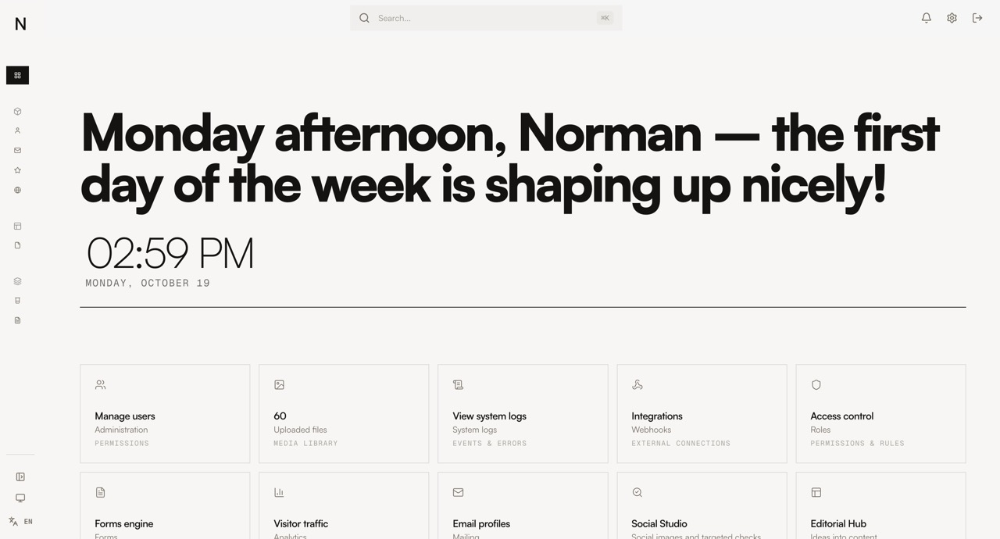
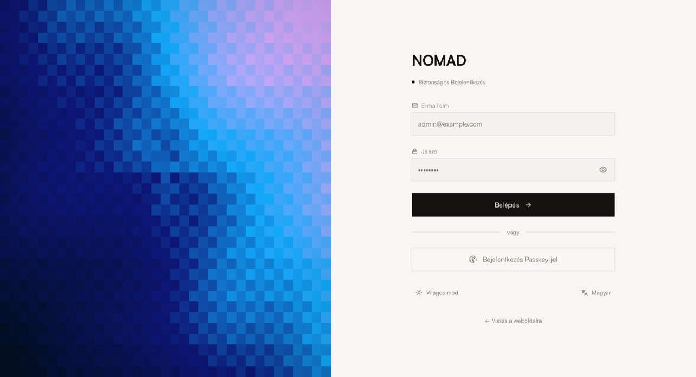
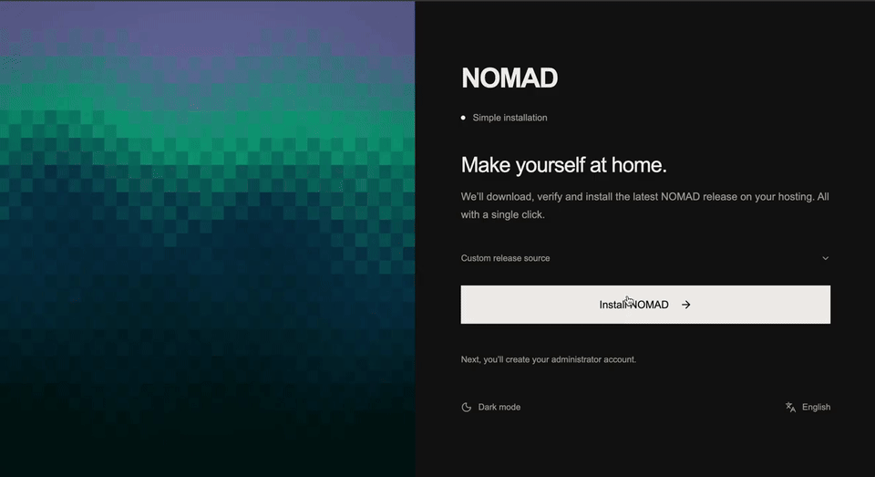

# NOMAD CMS — Releases

**Official release channel for [NOMAD CMS](https://github.com/vnorman1/Nomad-CMS--public-)** — a self-hosted, headless CMS built with PHP, SQLite, and React.

This repository hosts the standalone installer, versioned release packages, and metadata for NOMAD's built-in updater.

## Installation

1. Download [`nomad-setup.php`](./nomad-setup.php).
2. Upload it to an **empty HTTPS-enabled directory** on compatible PHP hosting.
3. Open `https://your-domain.com/nomad-setup.php` and follow the setup instructions.

No SSH or Composer is required for the standalone installer.

## Media

### Dashboard

### Login page

### Install

[Download the MP4 version](./media/install.mp4)

## Updates

NOMAD's updater uses [`release.json`](./release.json) and cryptographic package verification to deliver versioned updates, with rollback support where compatible.

[**Browse releases**](https://github.com/vnorman1/nomad-cms-release/releases)